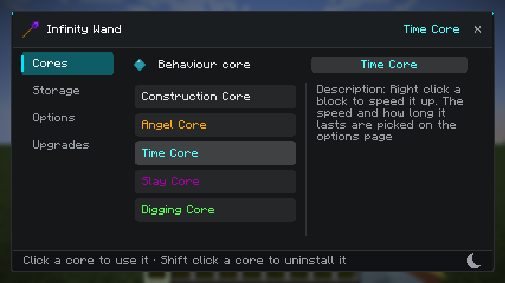
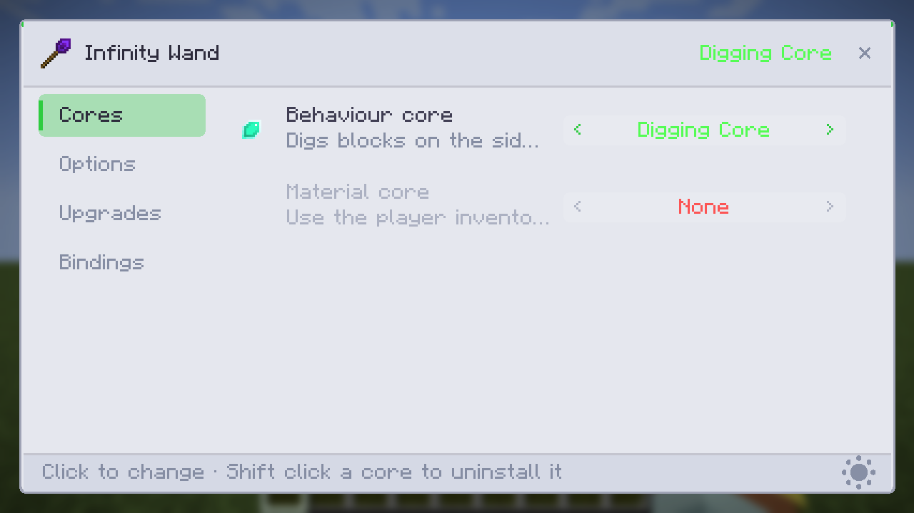
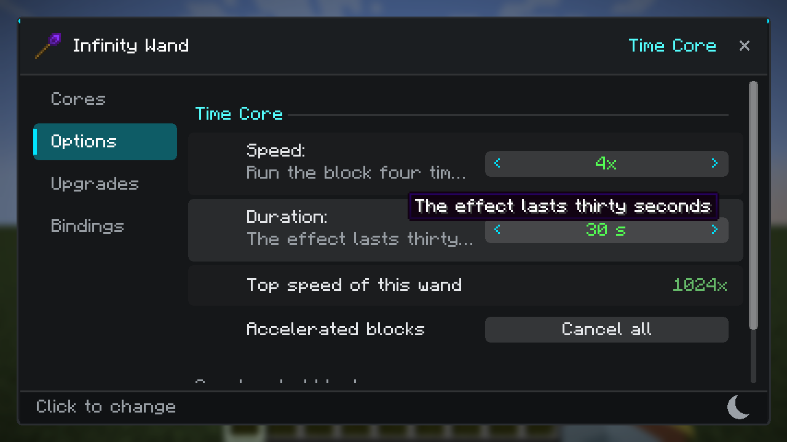
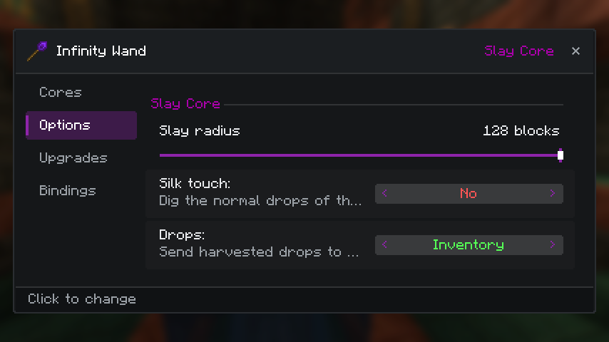
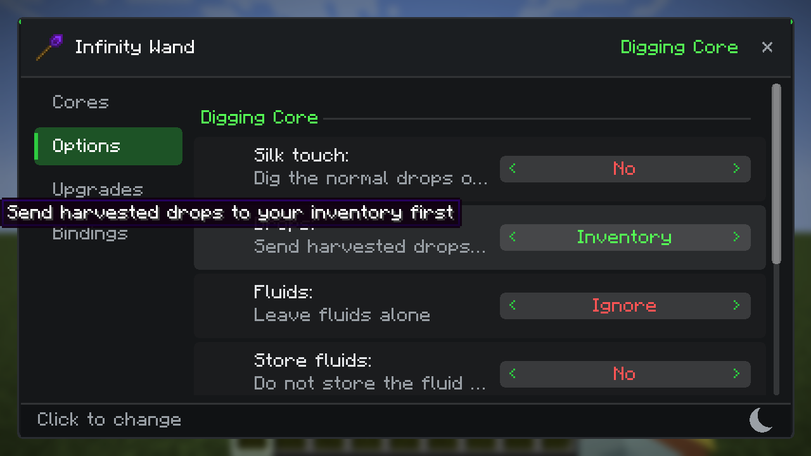
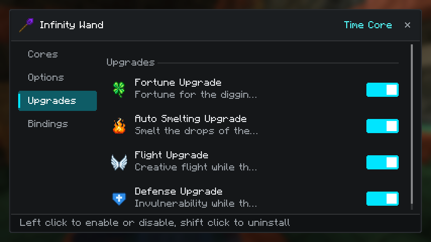
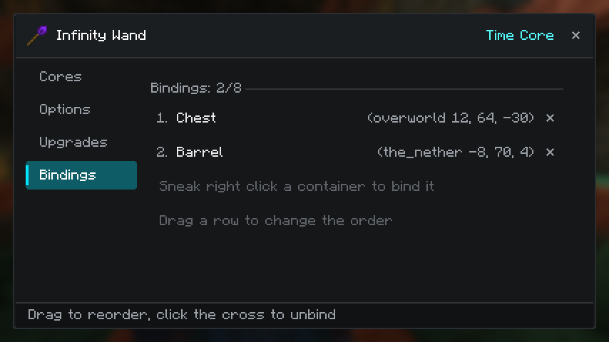

# ConstructionWand-Plus for 1.21.1 (NeoForge)

本工程原本是 [ConstructionWand-KOTS](https://github.com/GLDYM/ConstructionWand-KOTS)（Construction Wand 的
1.21.1 NeoForge 分支）。现在在它的基础上，把 **ConstructionWand-Plus** 的魔改内容按功能重新实现了一遍。

参考来源（都在同一个工作区里）：

- `ConstructionWand-1.20`：Plus 的 **1.20.1 Forge** 移植版，是本次移植的直接蓝本（架构最接近）；
- `ConstructionWand-Plus-main`：Plus 的原始 **1.12.2** 版本，用于核对语义与配置项。

- modid / 包名沿用 `constructionwand` / `dev.polaris_light.constructionwand`，所以它是 1.21.1 建筑手杖的
  **直接增强版**，物品与配方体系与原版一致；
- 新增内容集中在独立包 `dev.polaris_light.constructionwand.plus.*`，KOTS 原有代码保持可辨识，便于跟随上游
  与 KOTS 更新。

> 本工程保留 KOTS 的全部原有能力：无需潜行的功能键（默认左 Ctrl）、盔甲/Curios 栏供材、L2 背包、
> AE2 便携元件/无线终端、Tom's Storage、Refined Storage 无线终端、嵌套潜影盒读取、Sable 兼容等。

## 已修：手杖数据被写到手持物品上（不堆叠）

`WandOptions` 的构造函数会把选项**立刻写回栈**，而 `ItemWand.isTimeCore/isSlayCore` 这一类「问一句」的判定
对**任何手持物**都会构造它。于是**手里拿着石头（或任何物品）右键点方块**时，那一整叠就被塞进
`minecraft:custom_data:{wand_options:{}}`，从此和干净的同种物品不堆叠（`/setblock` 里能直接看到 60 个带标签、
4 个不带）。三层修复：

- `WandOptions`：`persist` 里先判断 `isWand(stack)`，**只有手杖才会被写入**；读非手杖栈时选项只存在内存里；
- `ItemWand.isTimeCore/isSlayCore`：先 `WandOptions.isWand(stack)` 再构造，从源头不再对非手杖栈发问；
- `WandData.writeRoot/removeRoot/update`：同样只对手杖生效，任何漏网调用都写不进去。

实测：手持 60 石头右键方块后 `components={…}` 里**没有** `custom_data`；手杖自己仍正常带 `wand_options`。
## 指令：游戏内设置加速上限（2.16.77）

新增（权限等级 2，需 OP）：

```
/cwand active            → 查看当前上限
/cwand active <0-4096>   → 设置上限（0 = 不限）
/constructionwand active ...  ← 同上，长名也可用
```

- 写入 `[time] maxActivePerPlayer` 后立即 `SPEC.save()`，服务器重启后仍生效；
- 与已有的 `/cwand limit <n>`（储存核心的绑定容器上限）并列，两者风格一致。

## 时间核心：不再顶掉之前加速的方块（2.16.76）

原因是一个隐藏上限：`[time] maxActivePerPlayer` 默认只有 **16**，而 `evictOldest(...)` 在超限时会把**最早那个**加速直接删掉——
所以第 17 个方块一加速，最早的就不见了。

现在：

- **默认值 16 → 256**（`defineInRange("maxActivePerPlayer", 256, 0, 4096)`）；
- **不再淘汰旧方块**：达到上限时拒绝新的那一个，并在动作栏提示「同时加速的方块已达上限（N 个），先解除一些再加」
  ```java
  if (!entries.containsKey(pos) && owned(entries, player.getUUID()) >= maxActive())
      return new Outcome(Result.LIMITED, 0, 0);
  ```
- 新增 `Result.LIMITED` 与 `constructionwand.time.limited` 文案；`maxActivePerPlayer = 0` 仍然表示不限。

## 界面：必定掉落并入强化时运（2.16.75）

「强制掉落所有战利品」(`slay_all_loot`) 本来也是**强化时运**的一部分，之前它单独显示在秒杀核心的选项里。现在：

- 选项页：它和倍率滑条一起，只在装了强化时运时出现
  ```java
  if (PassiveUpgrades.hasSuperFortune(wand)) {
      own.add(superFortuneSlider());
      own.add(extraCycle(ExtraWandOption.SLAY_ALL_LOOT));
  }
  ```
- 行为侧：读取该设置时也要求装有强化时运，没装时该项即使被写进数据也不生效
  ```java
  this.allLoot = PassiveUpgrades.hasSuperFortune(wand)
          && ExtraWandOption.getDisplayIndex(wand, ExtraWandOption.SLAY_ALL_LOOT) == 1;
  ```

## 界面：储存与选项标签互换、未安装强化不再显示其设置（2.16.74）

- 标签顺序改为 **核心 / 选项 / 储存 / 升级**（`Tab` 枚举里把 `OPTIONS` 与 `STORAGE` 互换）；
- `强化时运` 的滑条只在**装了该强化**时出现：
  ```java
  if (PassiveUpgrades.hasSuperFortune(wand)) own.add(superFortuneSlider());
  ```
  破坏/秒杀两条分支都加了判断，没装的强化不会再冒出它的设置项。

## 神化核心：灌注按手杖数值判定（2.16.71）

上一版把灌注行整个交回附魔台，结果是“条件不满足也能点”的反面——这次按需求让它**完全按手杖数值判定**：

```java
InfusionRecipe itemMatch  = InfusionRecipe.findItemMatch(level, item);              // 物品是否匹配某灌注
InfusionRecipe valueMatch = itemMatch == null ? null
        : InfusionRecipe.findMatch(level, item, eterna, stats.quanta(), stats.arcana());  // 手杖数值是否满足

if (slot == 2 && itemMatch != null && valueMatch == null) {   // 数值不够 → 不出现该行
    menu.costs[slot] = 0;  menu.enchantClue[slot] = -1;  menu.levelClue[slot] = -1;
    continue;
}
if (slot == 2 && valueMatch != null) {                        // 数值够 → 按配方要求定价，并把灌注提示发过去
    menu.costs[slot] = Math.min(menu.costs[slot], Math.max((int) Math.ceil(valueMatch.getRequirements().eterna()), 3));
    menu.enchantClue[slot] = registry.getId(infusionHolder.value());
    menu.levelClue[slot] = 1;
    PacketDistributor.sendToPlayer(player, new CluePayload(slot, List.of(new EnchantmentInstance(infusionHolder, 1)), false));
    continue;
}
```

即：灌注的**条件**用你固定的位阶/量子化/阿卡那去匹配配方，满足才出现该行、不满足就整行不出现；
价格仍按配方自身的要求（不会被高等级位阶哄抬）。

## 神化核心：行提示改用固定数值重算（2.16.68）

「永远显示效率 I」的原因：行提示（`enchantClue/levelClue`）是附魔台在 `slotsChanged` 里**用书架那套消耗**算出
“该行会给出什么魔咒”的结果；而我只重写了 `costs`，没有重算提示 → 提示停在第 1 级，实际 roll 用的是固定值的高等级。

现在 `refreshRows` 完整复刻它的提示计算：

```java
menu.costs[slot] = getEnchantmentCost(menu.random, slot, eterna, item);
if (menu.costs[slot] < slot + 1) menu.costs[slot]++;
menu.enchantClue[slot] = menu.levelClue[slot] = -1;
if (menu.costs[slot] > 0) {
    menu.random.setSeed(menu.enchantmentSeed.get() + slot);            // 与 getEnchantmentList 同一种子
    var list = ApothEnchantmentHelper.selectEnchantment(menu.random, item, menu.costs[slot], stats, registry.asLookup());
    if (list != null && !list.isEmpty()) {
        var data = list.remove(menu.random.nextInt(list.size()));
        menu.enchantClue[slot] = registry.getId(data.enchantment.value());
        menu.levelClue[slot] = data.level;
    }
}
```

于是三行消耗与三行提示都由固定数值算出，和点击后真正附出来的东西一致。

## 神化核心：受限提示改用 modifier 抬到目标位阶（2.16.66）

直接读了 Apothic 的界面源码，找到了那句提示的**确切条件**（`ApothEnchantmentScreen.java:305`）：

```java
float playerMax = (float) Minecraft.getInstance().player.getAttributeValue(Ench.Attributes.MAX_ETERNA);
if (playerMax < 100) → 显示「附魔能力受限」
```

也就是说它看的是**最终数值**，而层级加成是 **modifier**：低层级的 TierAugment 会往下减，
所以我上版只抬 `setBaseValue` 时最终值仍可能 < 100。现在改成用 modifier 把最终值顶到目标位阶：

```java
ResourceLocation id = ConstructionWand.loc("apoth_rank");
double before = attribute.getValue();
attribute.removeModifier(id);
if (before < rank) {
    attribute.addTransientModifier(new AttributeModifier(id, rank - before, ADD_VALUE));
}
player.connection.send(new ClientboundUpdateAttributesPacket(player.getId(), List.of(attribute)));
```

- 每次固定/写回都先移除旧 modifier 再加，所以不会叠加；
- 最后仍然把属性包发给客户端，界面立刻看到新值；
- 日志会打 `[apoth] rank limit value X -> Y wanted Z`，能直接确认最终值。

## 神化核心：把“受限”从客户端界面上真正的去掉（2.16.65）

用 `logs/latest.log` 里的 `[apoth]` 行确认了实际状态：

```
[apoth] pin BlockPos{x=117, y=71, z=39} rank=100 quanta=15 arcana=100 tier=4 was pinnacle
[apoth] pin done, tier now pinnacle
[apoth] refresh pos=… pinned=100/15/100 eterna=100.0
```

也就是说**服务端一直在用固定的 100 位阶**（这解释了“虽然显示受限但能附魔上”），问题只在**客户端显示**：
附魔台界面读的是客户端本地 `max_eterna` 属性的值，而我只在服务端抬了基础值，客户端不知道。

修复：抬完基础值后把该属性同步给客户端

```java
if(before < rank) attribute.setBaseValue(rank);
player.connection.send(new ClientboundUpdateAttributesPacket(player.getId(), List.of(attribute)));
```

另外把诊断日志收进“物品变化”分支，避免每 tick 刷屏（那次日志里 27 秒写了 543 行）。

## 神化核心：解除“附魔能力受限”（2.16.63）

界面上的「附魔能力受限」= `apothic_enchanting:max_eterna`（最大位阶属性）把你的位阶夹住了：
`EnchantmentTableStats.eterna(Player)` 里是 `Math.min(this.eterna, player.getAttributeValue(MAX_ETERNA))`。
世界层级没真正解锁时，这个属性上不去，于是固定 100 位阶会被夹到更低值（“刚刚还可以”大概是那一次层级加成刚好生效）。

现在固定时（以及每次写回表格数值前）会把这个属性的**基础值**抬到不低于固定位阶：

```java
var attribute = player.getAttribute(Ench.Attributes.MAX_ETERNA);
if (attribute != null && attribute.getBaseValue() < rank) attribute.setBaseValue(rank);
```

层级加成是 modifier，抬基础值不会破坏它的算法，只是保证固定值不再被削。

## 神化核心：种子改用玩家自己的附魔种子（2.16.62）

2.16.61 里我用 `enchantmentSeed + 1` 让报价“前进”，这不合适：

- 原版随机性的来源是 **玩家** 的 `enchantmentSeed`，每次附魔后由 `Player.onEnchantmentPerformed` 用
  `random.nextInt()` 换成一个**新的随机数**；附魔台只是把它当种子用；
- 手动 `+1` 等于给出一条可推演的序列（知道当前种子就能算出下一组报价），既不符合原版，也削弱随机性。

因此改成：

```java
menu.enchantmentSeed.set(player.getEnchantmentSeed());   // 与原版同一个来源
menu.random.setSeed(menu.enchantmentSeed.get());
```

于是：同一件物品在同一座台子上，**没附魔之前报价不变**（这就是原版行为），附完一次后玩家种子换成新随机数，
下一组报价随之变化。随机性与可预测性都由原版规则决定，没有额外削弱。

## 神化核心：三行重算与附魔台自己一致，并让种子前进（2.16.61）

- `refreshRows` 现在完整照抄附魔台自己的那一步：`getEnchantmentCost` → `enchantClue/levelClue = -1` →
  `costs[slot] < slot + 1` 时 +1 → 广播，所以三行消耗与等级数字跟固定值一致；
- **词条固定不变**的原因：附魔台用 `enchantmentSeed` 作为随机种子，我们在重算时反复用同一颗种子，
  于是同一件物品永远得到同一组词条。现在每次重算后 **把种子 +1**，换物品/再附魔都会得到新的组合；
- 界面“显示低等级、实际高等级”的差别来自客户端行提示的刷新时机（它以收到的 `costs` 与 stats 为准），
  这次 `costs` 也按固定值广播了，界面与结果应当一致；若仍有出入，下一步会把 `enchantClue/levelClue` 也按固定值算好再同步。

## 神化核心：进度授予改为逐条 criterion、注入器右键也取消点击（2.16.60）

- **层级仍显示“已锁定”**：`PlayerAdvancements.award` 必须给出**真实存在的 criterion 名**，写死 `"code_triggered"` 时不在该进度里就授不上。
  现在遍历 `advancement.value().criteria().keySet()` 逐条授予，层级进度才能真的完成。
- **注入器也改为“消耗右键”**：和附魔台一致 —— 右键注入器时取消点击（不打开它自己的界面），把位阶固定到该方块，并应用世界层级，
  动作栏提示「已固定：这座附魔注入器的位阶为 N（潜行右键取消）」。
- **注入器上限**：Enchanting Infuser 走 Apotheosis 行为时把上限写死为 50（`getEnchantmentPowerLimit` → 50），
  位阶高于 50 永远到不了。包装层现在把上限提升到已固定的最高位阶。

## 神化核心：真正“解锁”世界层级、行的提示交还附魔台（2.16.59）

**世界层级没真正解锁**：神化里“当前层级”与“已解锁层级”是两件事 —— 后者是一个**进度（advancement）**，
`WorldTier.isUnlocked` 只查进度。所以只写 attachment 时，CTRL+T 界面会显示“顶点（已锁定）”。现在 `applyTier`
除了写层级，还会**把到所选层级为止的所有层级进度都授予**玩家：

```java
for (int i = 0; i <= index; i++) {
    var advancement = player.server.getAdvancements().get(tiers[i].getUnlockAdvancement());
    if (advancement != null) player.getAdvancements().award(advancement, "code_triggered");
}
```

这样界面会变成“已激活”，层级加成（含 `max_eterna` 最大位阶）也真正算数。

**行提示**：`refreshRows` 之前把 `enchantClue/levelClue` 清成 -1，等于抹掉了附魔台自己算出来的那一行提示；
现在只重写三行消耗（`costs`）并广播，提示文字仍由附魔台自己决定。

**关于“附魔不了”**：位阶 100 时初始经验花费会到两千多点（需要 35 级），这是神化原本的曲线（高等级必然贵）；
而且 `max_eterna` 属性会把位阶夹到你的上限（界面提示“附魔能力受限”）。层级解锁修好后，属性上限应随层级提高。
如果仍然点不动附魔按钮，请告诉我：是**按钮灰着**、还是**点了没反应**、还是**提示等级不够**。

## 神化核心：世界层级只在右键时写，并且写得更硬（2.16.58）

按需求把 2.16.57 的“滑条即时生效”退回：世界层级**只在右键固定附魔台那一刻**写入。

同时把写入改成“先正常设一次，没成再直接改存档数据”：

```java
WorldTier.setTier(player, tier);                  // 正常路径：同步客户端 + 重算层级加成
if(WorldTier.getTier(player) != tier) {           // 被别的东西盖回去了，或者本来就是这个层级
    player.setData(Apoth.Attachments.WORLD_TIER, tier);
}
```

动作栏提示现在报告的是**读回来的实际层级**（`ApotheosisBridge.currentTierName(player)`），
如果它和滑条选的不一样，就说明写入被神化自己盖回去 —— 这条信息能直接定位问题。

## 神化核心：世界层级改为滑条即时生效（2.16.57）

之前世界层级只在**右键固定附魔台**时才写进玩家，所以单纯拖滑条看不到任何变化。现在 `PacketApotheosis` 的服务端处理里
在存好四项数值之后立刻 `ApotheosisBridge.applyTier(player, tier)`：

```java
if(ApotheosisLevels.setAll(wand, msg.tier(), msg.eterna(), msg.quanta(), msg.arcana())) { ... }
// 世界层级属于玩家而不是附魔台，滑动即生效，不必等下一次右键
if(ApotheosisBridge.isLoaded()) ApotheosisBridge.applyTier(player, msg.tier());
```

`WorldTier.setTier` 同时会移除旧层级、套用新层级的 TierAugment（其中就包括 `apothic_enchanting:max_eterna` 这个“最大位阶”属性），
并把层级同步给客户端。右键固定附魔台时仍会再应用一次，保证二者一致。

## 神化核心：把附魔台自己的“重算”也按固定值做（2.16.56）

上一版只在附魔台算完之后把数值写回去，于是**三行消耗与提示**仍按书架算出来的那一套，玩家看到的就是“数值恢复了”。
这一版直接把它那一步重做一遍：

- AT 打开 `EnchantmentMenu` 的 `random / enchantmentSeed / costs / enchantClue / levelClue`；
- `ApotheosisBridge.refreshRows(player, stats)`：用固定的位阶（经 `stats.eterna(player)`，最大位阶属性同样生效）
  重新
  ```java
  menu.setStats(stats);
  menu.random.setSeed(menu.enchantmentSeed.get());
  for (int slot = 0; slot < 3; slot++)
      menu.costs[slot] = ApothEnchantmentHelper.getEnchantmentCost(menu.random, slot, eterna, item);
  menu.broadcastChanges();
  ```
  `random` 每次都用 `enchantmentSeed` 重置种子，所以刷新是确定性的，不会每次闪出不同数字；
- 触发点：监测槽位物品，**物品一变就 refreshRows**；其余时间每 tick `setStats`，保证点下去那一刻 roll 用的是固定值。

如果这次实测仍显示书架数值，请把**三行消耗的数字**和把物品放进槽那一刻的截图发我——那样我能直接判断是哪一次重算覆盖了固定值。

## 神化核心：选项页去掉多余项、数值固定更硬（2.16.55）

**多余选项**：`方向/替换/随机/锁定/匹配` 和「当前行为核心每次只作用于一个方块」是 `buildOptions()` 里给**未知核心**准备的兜底设置
（`permissive = !shapes && !(slay) && !(time)`，神化核心当时被当成未知核心）。现在把 `ActionApotheosis` 也排除，神化核心的选项页只剩四个滑条 + 两行说明。

**固定更硬**：原来每 4 tick 才写回一次，且只在数值变化时才发包；玩家往槽里放物品时，附魔台会
`slotsChanged → gatherStats()` 把自己的数值算回书架值并**主动发给客户端**，而我们的发包被“值没变”挡住，于是界面看起来“数值又恢复了”。现在：

- **每 tick** 都 `menu.setStats(固定值)`（`ApothEnchantmentMenu.setStats` 是直接赋值，开销可忽略）；
- 监测槽位物品（`menu.getSlot(0).getItem()`）：**物品一变就立刻重发 `StatsPayload`**，把界面上的数值也拉回固定值；
- 因此放物品、换物品、点完附魔之后，界面与服务器使用的都是固定的位阶/量子化/阿卡那。

**仍存在的细节**：附魔台自己在 `slotsChanged` 里用当时的数值算出“三行消耗（等级）”，我们在其后才写回固定值，
所以那三行的等级数字仍可能按原书架值显示一瞬；**实际附魔结果与花费结算用的是固定值**（`clickMenuButton` 重新读 `this.stats`）。
若要让三行消耗也完全按固定值刷新，需要再接管它的消耗计算（AT 打开 `EnchantmentMenu.random/enchantmentSeed/costs` 后手工重算并广播），可以下一轮做。

## 修复：拖世界层级滑条崩溃（2.16.54）

崩溃报告 `错误报告-10-30-2026_20.16.20` 的根因：

```
java.lang.UnsupportedOperationException: Payload constructionwand:apotheosis_levels may not be sent to the server!
  at ModMessages.sendToServer(ModMessages.java:51)
  at ScreenWand.lambda$apotheosisTier$10(ScreenWand.java:714)
  at WandRow$Slider.mouseReleased(WandRow.java:844)
```

`PacketApotheosis` **从来没有在 `ModMessages.registerPayloads` 里注册**（当初打补丁时锚点没匹配上，静默漏掉了），
于是松开滑条的那一刻 NeoForge 拒绝发送未注册的 serverbound 载荷，直接在 `mouseReleased` 里抛异常把游戏崩掉。

修复：补上注册

```java
registrar.playToServer(PacketApotheosis.ID, PacketApotheosis.CODEC, PacketApotheosis.Handler::handle);
```

**验证**（客户端调 `ModMessages.sendToServer(new PacketApotheosis(4, 61, 62, 63))`，服务端读回）：

```
PROBE server sees tier=4 eterna=61 quanta=62 arcana=63 (want 4/61/62/63)
```

不再抛异常，四个值都写进了服务端法杖。

## 神化核心：右键改为「取消点击 + 固定数值」（2.16.53）

按需求改掉上一版的“不取消点击、按 tick 临时写回”：

- **右键附魔台 = 取消点击**（`setCanceled(true)` + `useBlock/useItem = FALSE` + `Result.SUCCESS`），桌面不会打开，
  和秒杀/时间核心接管点击的做法一致；客户端同样取消，所以不会预测性打开界面；
- **数值被固定在那个方块上**：新增 `ApotheosisPins`（`SavedData`，存于主世界 `constructionwand_apotheosis_pins`），
  记录 `GlobalPos → {位阶, 量子化, 阿卡那}`，**随存档持久化**，对所有玩家生效；
- **世界层级同时应用**：`WorldTier.setTier(player, tier)`；
- **之后打开这座台子**（空手或别的物品右键）时，每 4 tick 检查玩家是否开着 `ApothEnchantmentMenu`：
  用 `EnchantmentMenu.access`（新增 AT 公开该字段）取出菜单位置 → 有固定值就 `menu.setStats(固定值)` 并把
  `StatsPayload` 发给客户端（只在数值变化时发，避免刷包），因此玩家往槽里放物品触发 `gatherStats()` 覆盖后，
  下一次检查又会写回固定值；
- **潜行右键**取消该台子的固定，并给出动作栏提示；
- 反馈：固定时播放附魔台音效 + 附魔粒子 + 动作栏「已固定：位阶 88、量子化 33、阿卡那 55，世界层级 攀升」。
- 注入器不受影响：它有自己的界面，右键仍然打开，只是把位阶写进去。

**真机验证**（探针直接 post 真实的 `PlayerInteractEvent.RightClickBlock`）：

```
PROBE cancelled=true useBlock=FALSE result=SUCCESS pins=1 pinned=88/33/55   ← 点击被吃掉，数值固定成功
PROBE world tier now ASCENT                                                ← 同时应用了世界层级
PROBE saved nbt=1 reloaded=88/33/55                                        ← 固定值随存档持久化
PROBE after sneak cancelled=true pins=0                                     ← 潜行右键取消固定
```

`gradlew build` 通过（548KB）；`gradlew runServer`（装有六个 mod）→ `1459 配方`、`Done (0.758s)`、无异常。

## 神化核心：真机验证（2.16.52）

把 Apotheosis 8.9.0、Apothic Enchanting 1.6.4/1.6.2、Placebo 9.9.2/9.9.4、Apothic Attributes、Enchanting Infuser 21.1.4、Puzzles Lib 21.1.66
装进 `run/mods`（`run*` 在 `.gitignore` 里，不入库），把开发用的 `neo_version` 从 `21.1.230` 提到 **`21.1.235`**（Apotheosis 要求 `[21.1.235,)`），
然后跑客户端探针实测，日志（原样摘录）：

```
PROBE loaded apotheosis=true apothic=true infuser=true core=true      ← 三个 mod 在时核心才注册
PROBE wand tier=3 eterna=77 quanta=42 arcana=66                        ← 四项数值存/读正确
PROBE world tier now SUMMIT / PINNACLE (wanted summit / pinnacle)        ← WorldTier.setTier 生效
PROBE block=ApothEnchantingTableBlock entity=none                      ← 原版附魔台确实被换成了神化的类
PROBE shelves give  eterna=30.0 quanta=15.0 arcana=0.0 clues=1         ← 桌面自身（书架）算出的值
PROBE wand writes  eterna=77.0 quanta=42.0 arcana=66.0 clues=1         ← ApotheosisBridge.statsFor 的结果
PROBE infuser rank=60 shelves=32 total power=60.0                      ← 注入器被设成 60 位阶
PROBE infuser without rank would be 64.0                               ← 不设时是书架自然的 64
```

- **世界层级**：`HAVEN…PINNACLE` 全部通过 `WorldTier.getTier` 读回一致；
- **桌面数值**：`statsFor(...)`（`applyStats` 用的就是它）返回的三项正好是滑条设置，`clues` 等仍取自书架；
- **注入器**：32 个书架时总和 **60.0**，正好等于设定的位阶；不设rank时是自然的 64.0，说明是"替换"而不是"叠加"；
- 截图 `docs/wand-screen-apotheosis.png`：选项页四个滑条（World tier = Pinnacle、Rank 77、Quanta 42、Arcana 66），主题强调色也随核心变成紫色。

**未能自动化的一步**：探针世界里放的附魔台没有生成方块实体（`entity=none`），因此无法真正打开 `ApothEnchantmentMenu` 去验证 `menu.setStats(...)`。
代码路径是：`player.containerMenu instanceof ApothEnchantmentMenu` → `menu.setStats(statsFor(...))`，公开 setter，
并且按 tick 重复写回；真机上右键附魔台即走这条路径。

## 神化核心：接入附魔注入器（2.16.51）

Enchanting Infuser 的两个注入器没有“附魔台属性”，它的力量来自四周书架，而且是**通过它自己的静态 `EnchantingBehavior` 询问**的。
所以这一轮不写方块数据，而是接管那个静态：

- `InfuserBridge`（唯一引用 `fuzs.enchantinginfuser.*` 的类，只有 mod 存在时才会被类加载）：
  - 右键注入器时记下 `GlobalPos → 位阶`（`setRank`），并安装包装后的行为；
  - `Ranked implements EnchantingBehavior`，除两个方法外全部转交给原来那一个：
    - `getEnchantmentPower(shelf, …)`：如果这个书架属于被写入过的注入器，返回 `位阶 / 该注入器书架数`，于是**书架总和恰好等于你设定的位阶**（不是叠加）；
    - `getEnchantmentPowerLimitScale(…)`：返回 `max(原值, 位阶 / 15)`，保证 100 位阶不会被原来的上限削掉。
- **递归防护**：注入器的 `isValidBookShelf` 内部也会调用 `EnchantingBehavior.get().getEnchantmentPower(...)`，包装后就会自己问自己。
  因此加了一个 `ThreadLocal` 守卫：包装里调用 `isValidBookShelf` 时一律走原值，那次询问不会再进入我们的计算。
- **安装时机**：注入器会在配置重载时用 `EnchantingBehavior.set(...)` 覆盖回自己的实现，而它没有事件可挂。
  所以两边各加一次“廉价重装”：服务端 `ServerTickEvent`、客户端 `ApotheosisClientEvents`（`ClientTickEvent.Post`）里做
  `if(EnchantingBehavior.get() != installed) 重新包装`，只是字段比较，开销可忽略。
- 选项页末尾增加一行说明：**注入器只认位阶**，量子化/阿卡那对它无效（这是它的模型决定的，不是我们没做）。
- 依赖：`maven.modrinth:enchanting-infuser:v21.1.4-1.21.1-NeoForge` + `maven.modrinth:puzzles-lib:21.1.66`（compileOnly）。

**验证**：`gradlew build` 通过（544KB）；`gradlew runServer`（无这三个 mod 的环境）→ `Done (0.823s)`、1306 配方、无 `NoClassDefFoundError`
——说明没有安装依赖时，`InfuserBridge` 完全不会被类加载。

## 新核心：神化核心（2.16.50）

与 **Apotheosis 1.21**（世界层级、宝石粉）和 **Apothic Enchanting 1.21**（附魔台、位阶/量子化/阿卡那）联动的行为核心。

**注册**：`PlusItems.CORE_APOTHEOSIS = registerIfAllLoaded("core_apotheosis", {"apotheosis", "apothic_enchanting"}, ...)`，
两个 mod 都在才存在；所有引用这两个 mod 类型的代码集中在 `plus/compat/apotheosis/ApotheosisBridge.java`，只有核心存在时才可能被类加载
（做法与 ProjectE 的 `EmcAccess` 相同）。

**四个数值**（存在法杖 `custom_data`，默认 位阶 30 / 量子化 15 / 阿卡那 0 / 世界层级 0）：

| 选项 | 范围 | 作用 |
|---|---|---|
| 世界层级 | 0–4（HAVEN/FRONTIER/ASCENT/SUMMIT/PINNACLE） | 右键时用 `WorldTier.setTier(player, tier)` 写入，同时让神化重算层级加成（含“最大位阶”） |
| 位阶（Eterna） | 0–100 | 写入附魔台，决定可用魔咒等级 |
| 量子化（Quanta） | 0–100 | 写入附魔台，调节威力浮动 |
| 阿卡那（Arcana） | 0–100 | 写入附魔台，让稀有魔咒更常见 |

**选项页**：选中神化核心后，四个滑条取代原来的通用设置；滑条与 `PacketApotheosis` 同步，服务端负责 clamp。

**右键附魔台**：`ApotheosisCoreEvents` 在 `PlayerInteractEvent.RightClickBlock` 里识别
`state.getBlock() instanceof EnchantingTableBlock`（原版附魔台在运行期被神化换成了它的子类，所以原版 / 神化桌 / 乌鸦桌一次判定全覆盖），
不取消点击（桌面照常打开），随后 `ServerTickEvent` 在桌面打开期间每 tick 把数值写上去：

```java
EnchantmentTableStats base = EnchantmentTableStats.gatherStats(level, pos);
menu.setStats(new EnchantmentTableStats(eterna, quanta, arcana,
        base.clues(), base.blacklist(), base.treasure(), base.stable()));
```

之所以按 tick 重写：玩家往槽里放物品会触发 `slotsChanged → gatherStats()`，把数值覆盖回书架算出的原值；一分钟内持续写回可以保证
“放物品 → 点按钮”这段过程里数值始终是我们设定的。书架的线索数、黑名单、宝藏标记与稳定性仍来自房间本身，只替换三个数值。

**配方**（`core_apotheosis.json`，用 `neoforge:mod_loaded` 条件，缺 mod 时静默跳过）：

```
 G
GEG
 G
```
`G` = `apotheosis:gem_dust`（宝石粉），`E` = `minecraft:enchanting_table`。

**验证**：`gradlew build` 通过；`gradlew runServer`（未装这两个 mod 的环境）→ `Done`、1306 配方、无异常，说明核心与配方都能在缺少依赖时安全缺席。

**下一步**：接入 `enchantinginfuser` 的两个注入器（它只有“位阶”一个入口，走它自己的 `EnchantingBehavior`）。

## 修复：绑定列表的拖动排序（2.16.49）

绑定行搬进右栏以后，`mouseClicked` 拿到的行是**两栏块**而不是绑定行，
`row instanceof WandRow.Binding` 判断失败，`dragFrom` 永远设不上——所以拖拽排序失效了。

- 新增 `hostedRow(row, x, y)`：若命中的是两栏块，就返回光标下真正的右栏行；
  `mouseClicked` 用它解析后再判断「抓住绑定行」；
- 新增 `allRows()`（页面所有行，含块内 extras）：拖动预览 `renderDragState` 与 `bindingRowAt` 都改用它，
  高亮/落点线在块内也能正确显示；
- 实测（探针模拟一次完整拖拽）：`hosted=Binding`、`dragFrom/dragTo 0→1`、松手后顺序由
  `[x=9, x=11]` 变为 `[x=11, x=9]` ✔

## 储存页：ProjectE 核心显示玩家 EMC（2.16.48）

`buildBindings()` 之前只处理了仓储核心与 ME 核心，ProjectE 核心落到「当前物品核心没有绑定」。现在补上第三个分支：

```java
if(isMaterialCore(PlusItems.CORE_PROJECTE)) {
    EmcStatus emc = emcStatus();          // 读 PECapabilities 的 IKnowledgeProvider.getEmc()
    rows.add(new WandRow.Text(text("gui.binding.projecte"), Component.literal(emc.value()), emc.color(), true, null));
    rows.add(new WandRow.Paragraph(Component.empty(), text("gui.binding.hint_projecte")));
    return;
}
```

- `gui.binding.projecte` = 「EMC」，值按千分位格式化（`EmcAccess.read`），有 EMC 时用 `Ui.OK`、没有时用 `Ui.TEXT_OFF`；
- 没有 ProjectE 知识时显示「无 ProjectE 知识」；下面一行是「以玩家 EMC 作为方块来源与掉落去向」；
- 该分支只在物品核心是 ProjectE 核心时可达，所以 `EmcAccess`（引用 ProjectE 类型）不会在没有 ProjectE 的环境里被加载。

## 储存页：绑定信息进右栏、紧跟描述文字下面（2.16.47）

- `WandRow.TwoColumn` 增加 `extra(List<WandRow>)`：右栏在描述文字下面继续排这些行（自动设 x/宽度/高度，
  并把 `mouseClicked`/`mouseDragged`/`mouseReleased` 转给它们），块高度把右栏内容算进去；
- `buildStorage()` 改为先把绑定行构建到一个局部列表，再 `corePicker(...).extra(bindings)`，绑定信息就落在描述下面；
- `bindingRowAt()` 也扫块的 extras，所以**拖动排序仍然有效**；
- 绑定提示语改成 `Paragraph`（会折行），不再被窄栏裁成 `contai…`；
- 截图 `docs/wand-screen-storage.png`：`描述：…` → `Bindings: 0/8` → `Not bound` → `Sneak right click a container to bind it`，全在右栏。

## 核心列表：文字回归核心色、列表按内容收窄、储存页保留绑定区（2.16.46）

- **文字颜色**：不再用 `Ui.OK` 覆盖，一律 `Ui.TEXT`，让语言文件里的 `§` 颜色码生效——建筑核心（无颜色码）显示白色，
  时间青色、秒杀紫色、挖掘绿色、毁灭红色照旧；
- **描边颜色**：`-1`/`0`（建筑核心、无物品核心）改为**白色**（之前落到主题强调色，看起来发青），其余核心 `| 0xFF000000`；
- **列表宽度**：`columnWidth()` 按最长条目标签算（`widest + 22`，上限仍是半宽），核心列表不再占半个面板，描述栏变宽；
- **储存页绑定信息**：上一版把整页剩余高度全给了列表，`Bindings:` 被挤出视口。现在先构建一次绑定区量出高度，
  再把「剩余高度 − 绑定区高度」交给列表，绑定区始终在列表下方可见；
- 截图：`docs/wand-screen-cores.png`（建筑核心白色文字 + 白色圆角描边、列表变窄）、`docs/wand-screen-storage.png`（绑定区可见）。

## 核心列表：描边颜色补 alpha、第一条不再被裁（2.16.45）

- **为什么只有毁灭核心和建筑核心有描边**：各核心的 `getColor()` 返回的是**不含 alpha 的 RGB**（如 `ItemCoreTime.CORE_COLOR = 0x00E5FF`、
  挖掘 `0x2ECC40`），alpha 位是 0，画出来完全透明；只有 `CoreDefault`（`-1`，纯白）和 `CoreDestruction`（`0xFFFF0000`）自带 alpha 才可见。
  现在统一走 `Ui.fromCoreColor(...)`（补 `0xFF000000`，`0/-1` 时用主题强调色），所以每个核心都能看到自己的颜色；
- **第一条描边被裁**：列表窗口的裁剪区原本从 `y+4` 开始，而描边画在 `entryY-1`，第一条正好压到裁剪边缘。现在列表内容从 `y+6` 开始、
  裁剪区从 `y+4` 开始，留下 2px 余量，第一条的描边完整可见；`height()`/点击换算同步 +2。
- 截图 `docs/wand-screen-cores.png`：选中的时间核心是**青色圆角描边**（不再是白色），悬浮的天使核心只有更亮的底板。

## 核心列表：描边贴合圆角、悬浮不再加描边（2.16.44）

- `Ui.outline` 换成 `Ui.outlineRounded`：先按圆角画一圈核心色，再把内部用窗口底色（`Ui.BACKGROUND`）挖掉 1px，
  留下的是**沿圆角走的一圈 1px 描边**（四直线做法会把角削平，所以不用了）；
- **悬浮态不再加描边**（按你的要求）：只把底板提到 `0x3CFFFFFF` 并把文字转 `Ui.OK`；
- **选中态**：圆角描边（核心色）+ 内部 `0x2EFFFFFF` 底板；
- 截图 `docs/wand-screen-cores.png`：毁灭核心选中 → 红色圆角细边；鼠标停在时间核心 → 只有更亮的底板，没有描边。

## 核心列表：描边改成真 1px 边框、悬浮更亮（2.16.43）

上一版用「外扩 1px 的实心圆角矩形垫底」做边框，内层底板是半透明的，结果**整块都被核心色灌满**（截图里毁灭核心是一条实心红条）。
现在改为真正的描边：

- `Ui.outline(graphics, x, y, w, h, color)`：用四条 1px `fill` 画边框；
- **选中**：正常底板（`0x2EFFFFFF`）+ 外圈 1px 核心色描边（先画底板，再画边框，颜色不会透过来）；
- **悬浮**：底板提到 `0x3CFFFFFF`（比原来的 `ROW_HOVER` 亮很多）+ 外侧 `0x66FFFFFF` 细边框，文字转 `Ui.OK`；
- 截图 `docs/wand-screen-cores.png`（毁灭核心被选中，红框；鼠标停在时间核心上，白框 + 亮底板）。

## 核心列表：悬浮高亮 + 选中项按核心颜色描边（2.16.42）

- `WandRow` 记录最近一次绘制时的鼠标位置（`mouseX/mouseY`），让自行绘制内容的行也能判断悬浮；
- `TwoColumn.Entry` 增加 `int color`（`ScreenWand.corePicker` 传 `core.getColor()`）；
- 列表条目三种状态：
  - 普通：`0x12FFFFFF` 圆角底；
  - **悬浮**：`Ui.ROW_HOVER` 底 + 文字转为 `Ui.OK`；
  - **选中**：`0x2EFFFFFF` 更亮的底，**外加 1px 核心色描边**（先用核心色画一个外扩 1px 的圆角矩形，再在上面盖内层底板，省掉画线工具）。
- 实测（截图 `docs/wand-screen-cores.png`）：选中的「时间核心」有一圈青色描边；悬浮态需要真实鼠标移动，探针里 `glfwSetCursorPos` 在 GUI 抓取光标时不会改变 MC 的鼠标坐标，所以图上未能呈现。

## 核心页：加横向分割线（2.16.41）

新增 `WandRow.Divider`（高 7px、1px 的 `Ui.DIVIDER` 线、跨整栏宽），插在「行为核心」那一行和两栏块之间；
储存页的「物品核心」行下同样一条。现在核心页的分割结构是：

```
行为核心                            时间核心      ← 只读
──────────────────────────────────────────────  ← 横向分割线（新）
[核心列表]                    │  描述：……
[核心列表]                    │
```

## 核心页：整页不再出现滚动条（2.16.40）

上一版铺满窗口后，**整页**在面板最右边又出现了滚动条——原因是两栏块自身在给的窗口高度上还有 8px 内边距（`height()` 里 `viewport + 8`），
而行间距又被计了一次，于是内容比视口高 2px，`Ui.scrollBar` 就把它画了出来。现在 `roomLeft()` 一并扣掉块内边距与行间距：

```java
return Math.max(WandRow.ROW_HEIGHT, contentHeightPixels - used - ROW_GAP - 12);
```

实测：核心页面板右侧**不再有整页滚动条**，只有左栏列表需要时才出现它自己的滚动条（分割线左侧）。

## 核心页：窗口保持高、内容铺满整个窗口（2.16.39）

上一版把窗口按内容收高，结果整个面板变得很扁。改回**固定高度**（`layout()` 里身高逻辑恢复：可用高度的 4/5，夹在 270–`MAX_PANEL_HEIGHT`），
改由**内容铺满窗口**：

- `refresh()` 先算几何再建行，页面可以知道"还剩多少高度"；
- 新增 `roomLeft()` = `contentHeightPixels − 已用行高 − 间距 − 6`，传给两栏块（`WandRow.TwoColumn(entries, desc, fill, onSelect)`）；
- 左栏列表窗口取 `max(自然高度, fill)`，所以核心少时窗口照样铺到底，核心多时才出现自己的滚动条；
- 多留 6px 余量，避免整页出现 2px 的滚动条；
- 截图：`docs/wand-screen-cores.png`、`docs/wand-screen-storage.png`。

## 核心页：描述带「描述：」、窗口按内容收高、核心描述全部重写（2.16.38）

- **右栏改为「描述：<正文>」**：`corePicker` 把 `gui.status.description` 前缀拼在描述前面，和原来核心状态区的格式一致；
- **窗口高度按内容收口**：新增 `applyPanelHeight(needed)`，`refresh()` 在排完行后按 `contentHeight` 重新定高（`HEADER+FOOTER+8+内容`，
  下限 180、上限 `MAX_PANEL_HEIGHT` 与屏幕可用高度），再重排一次行——修掉「底下都是空的」；
- **所有核心描述重写**（中英各 4 条，其余核对过仍然准确）：
  - 时间核心：原来还写着「每点一次提升一档倍速」，已改为「右键方块使其加速；倍率与持续时间在选项页里调整」；
  - 挖掘核心：补上「精准采集、掉落去向、流体处理与强化时运都在选项里设置」；
  - 秒杀核心：补上「秒杀半径是选项页里的滑条」；
  - 仓储核心：说明「挖掘产物也可以存入其中」；建筑/天使/毁灭/ME/ProjectE 的描述核对后保持原样。
- 截图：`docs/wand-screen-cores.png`、`docs/wand-screen-storage.png`。

## 核心页：两栏互相独立（2.16.37）

按标注继续修：

- **第一行图标回来了**：`selectedCoreRow` 现在传 `coreIcon(option.get())`，`行为核心` 左边显示当前核心的图标，右侧值框照旧、无箭头；
- **两栏完全独立**：左栏是一个固定高度的列表窗口（默认显示 4 条），**自己的滚动条画在分割线左侧**（`Ui.scrollBar`），
  鼠标滚轮在左栏内只滚左栏（`WandRow.mouseScrolled` → 屏幕先问行、再滚整页），右栏描述不随列表滚动；
- **去掉整块的大圆角灰底**：`WandRow.TwoColumn.background()` 返回 `false`，不再画整片底板；
- **每个核心都有自己的圆角底**（`0x12FFFFFF`），**选中的更亮**（`0x2EFFFFFF` + `Ui.OK` 文字），不再是隔行条纹；
- 列表打开时自动滚到当前选中的核心，避免选中的那条藏在窗口下方；
- 截图：`docs/wand-screen-cores.png`。

## 核心页：第一行原样保留值框、下面左右两栏列表（2.16.36）

- **第一行与原来一模一样**：`行为核心` + 右侧**值框**里显示当前核心（`WandRow.Cycle` 的 `arrows=false` 只画框、不画 `‹ ›`），
  且不再响应点击；储存页的 `物品核心` 行同理；
- **下面分成左右两栏，带竖分栏线**（`WandRow.TwoColumn` 重写）：左栏每个核心**各自一个圆角行框**（选中项用 `Ui.OK` 文字、隔行轻微条纹），
  中间一条 1px 竖线（`Ui.DIVIDER`），右栏是当前核心的完整描述（按栏宽折行）；
- **列表不带图标**（按标注），行高 20 + 间隔 4，点击按行高换算，落在间隔里不触发；块高度随条目数增长，页面可正常滚动；
- 截图：`docs/wand-screen-cores.png`、`docs/wand-screen-storage.png`。

## 核心页：第一行只显示，下面左右两栏（2.16.35）

按标注图重做布局：

- **第一行不变**：`行为核心  时间核心` —— 只显示当前核心，不再有 `‹ ›` 值框，也不再负责选择；
- **下面分成左右两栏**（新控件 `WandRow.TwoColumn`）：左栏是**核心列表**（每个已装行为核心一行，带图标与名字，当前核心用 `Ui.OK` 高亮），
  右栏是**描述**（当前核心的完整描述，按右栏宽度自动折行）；点左栏任意一行即选中该核心，SHIFT+左键卸下（`PacketRemoveCore`）；
- **储存页（第 2 位）同理**：`物品核心  Storage Core` 一行 + 左栏物品核心列表 / 右栏描述，下面接原来的绑定信息
  （`Bindings: 0/8`、`Not bound`、`Sneak right click a container to bind it` 等）；
- 控件细节：列表行高 16（容纳 16px 图标），描述行高 10；点击按行高换算，右栏不响应点击；页脚提示改为
  `Click a core to use it · Shift click a core to uninstall it`（新键 `gui.hint.select`）。

截图：`docs/wand-screen-cores.png`、`docs/wand-screen-storage.png`。

## 核心页改为列表选择 + 储存页（2.16.34）

- **核心页不再用「‹ 值 ›」循环选择**：改为 **核心列表**，每个已装的行为核心一行，点哪一行就选哪个（`selectCore` → `option.set(core)` + `PacketWandOption`），
  当前核心在右侧显示 `Selected` 并高亮；SHIFT+左键卸下该核心（`PacketRemoveCore`）。列表下方是当前核心的完整描述（折行，不裁剪）。
  行控件为此给 `WandRow.Cycle` 加了 `arrows` 开关：列表行不画值框和箭头，避免看起来像"继续点就能换"。
- **物品核心与绑定页合并为「储存」页**（放在第 2 位）：页面内容 = 物品核心列表（同样点选）+ 完整描述 + 原来的绑定信息
  （已绑定容器 `0/8`、ME 网络、EMC、绑定提示）；`Tab` 由 `CORES/OPTIONS/UPGRADES/BINDINGS` 改为 `CORES/STORAGE/OPTIONS/UPGRADES`。
- 语言新增 `gui.tab.storage`（储存/Storage）、`gui.section.core_list`（核心列表/Core list）、`gui.section.material_list`（物品核心/Material cores）、
  `gui.selected`（已选/Selected）、`gui.core.select_hint`（左键选用，SHIFT+左键卸下）。

截图：`docs/wand-screen-cores.png`（核心列表）、`docs/wand-screen-storage.png`（储存页）。
## 强化时运升级（2.16.27）

- **物品** `constructionwand:upgrade_super_fortune`（强化时运升级），已注册、有**自己的贴图** `textures/item/upgrade_super_fortune.png`
  与模型（`item/generated` + `item/upgrade_super_fortune`），配方：
  `时运升级 + 4 钻石块 + 4 金块`（钻石块在上下左右，金块在四角）；
- **不使用原版时运公式**：装上后挖掘用的是**最终掉落列表 ×倍率**（`DigSnapshot.multiplyDrops`，超过堆叠上限自动拆叠），
  同时把 loot table 看到的时运等级强制为 0（`fortune = hasSuperFortune ? 0 : fortuneOf(player)`）；秒杀则在 `ItemEntity`
  掉落拦截处对每份掉落同样乘倍率，因此**挖掘与秒杀都生效**；
- **倍率选项（无级滑条，2.16.33）**：选项页用滑条控件（`WandRow.Slider`），范围是**连续整数 1..上限**（无尽 128、钻石 16、铁 8、石 4，`[superFortune]` 可覆盖），
  数值实时跟随、松手才提交；倍率**不再是离散档位**，存成手杖上的一个整数标签 `super_fortune`（`SuperFortuneLevels.get/set`），
  改值通过新包 `PacketSuperFortune(int)` 同步到服务端（服务端按档位上限二次夹取）。1 = 不加倍；不提供 0，因为 0 会直接把掉落清零，
  上限按手杖分档：石 4 / 铁 8 / 钻石 16 / 无尽 128，可在服务端配置 `[superFortune] stone|iron|diamond|infinity` 覆盖；
- **秒杀专有选项** `强制战利品: 是/否`（`ExtraWandOption.SLAY_ALL_LOOT`）：开启后额外把该实体战利品表能出的**每一种**物品各发一份，
  走同一条投递管线（所以目标去向与倍率照样生效）。

### 掉落清单怎么来的（2.16.29 改成穷举，思路借鉴 Just Enough Resources）

原版只提供"回滚"（`LootTable#getRandomItems`），没有任何"列出这张表能掉什么"的 API，所以我最初用的是**回滚 200 次取并集**——
它的毛病是概率性：2.5% 的条目 200 次有 0.6% 概率漏掉，0.5% 的条目漏掉的概率高达 37%，并不能算"所有可能"。

`mods/JustEnoughResources-master` 里查看生物掉落的做法给了正解：**用 access transformer 打开战利品表内部字段，逐池逐条遍历**。
它的 `NeoForge/src/main/resources/META-INF/accesstransformer.cfg` 里就是这几行（`LootTable.pools`、`LootPool.entries`、
`LootItem.item`、`DynamicLoot.name` 等），`LootTableHelper.toDrops` 再按 entry 类型取物品、按 weight 算概率。

我据此（**重新实现，没有复制其代码**）加了 `plus/basics/LootTableWalk`：

- 自己的 AT 追加 7 行：`LootTable.pools`、`LootPool.entries`、`LootItem.item`、`TagEntry.tag`、`NestedLootTable.contents`、
  `CompositeEntryBase.children`、`DynamicLoot.name`；
- 遍历规则：`LootItem` → 该物品；`TagEntry` → 标签里**每个**成员（`HolderSet.Named` 展开）；`NestedLootTable`/`DynamicLoot`
  → 递归子表；`AlternativesEntry`/`SequentialEntry`/`EntryGroup`（都继承 `CompositeEntryBase`）→ 递归子条目；去重、限深 8 层、防环；
- 遇到不认识的 entry 类型（模组自定义）就**静默跳过**——和 JER 这类查看器一样，不再退回 200 次回滚采样（2.16.30 去掉；僵尸表实测结果不变，说明那段兜底本来也没贡献）。

贴图与名字的两个细节（2.16.31）：

- 贴图文件原名是 `upgrade_fortune+.png`，但 **`+` 不是合法的资源路径字符**（`ResourceLocation.isAllowedInResourceLocation` 只接受
  `a-z 0-9 _ - . : /`），所以重命名为 `upgrade_super_fortune.png`；这也正好符合 datagen 的命名约定
  （`ItemModelGenerator` 对每个物品生成 `item/<registry_name>`），下次跑 `runData` 不会被覆盖掉；
- 物品名原来显示成裸键 `item.constructionwand.upgrade_super_fortune`，因为只加了升级描述键、漏了**物品名键**；现在补上
  `item.constructionwand.upgrade_super_fortune`（中英各一条），tooltip 首行显示「强化时运升级 / Super Fortune Upgrade」。
实测（倍率部分）：`caps infinity=128 diamond=16 stone=4`、`infinity multiplier=128`、`multiplyDrops` 把 1 煤 → 128、2 钻石 → 256（自动拆成 6 堆）；
未装升级时 `multiplier=1`。选项页截图见 `docs/wand-screen-super-fortune.png`（`Super fortune: 128x`）。

**强制战利品的端到端验证**（`2.16.28` 修正了调用点）：一开始把 `dropEveryPossibleItem` 挂在 `forceDeath` 里，而秒杀走的是 `forceKill`，
所以那次探针只看到 `rotten_flesh=4`（只有倍率生效）。现在改在 `slaySingle` 中、`SLAYING` 上下文仍有效时调用。服务端探针（假玩家 + 生成僵尸 + `slaySingle`，
`SLAY_ALL_LOOT=yes`、强化时运 2x）结果：

```
PROBE set=true display=1
PROBE drops={rotten_flesh=6, potato=2, iron_ingot=2, carrot=2}
```

对照：僵尸战利品表单次回滚只出 `rotten_flesh`，200 次回滚的并集是 `{rotten_flesh, potato, iron_ingot, carrot}`（另一次探针实测），
所以土豆/铁锭/胡萝卜各 2 个正是"每种可能掉落 1 份 × 2 倍"，普通掉落 1–2 份腐肉 × 2 也吻合。

改成纯遍历后再测一次（2.16.30）：`PROBE walker=[rotten_flesh, iron_ingot, carrot, potato]`、`PROBE drops={rotten_flesh=4, iron_ingot=2, carrot=2, potato=2}` —— 与带采样兜底时完全一致。
## 界面组合键固定为 Ctrl+Shift+右键（2.16.26）

`guiKeyCombDown()` 原来是 `OPT && (Shift || !SHIFTOPT_GUI)`，默认 `SHIFTOPT_GUI=false` 时 **Ctrl 单独**就会开界面，
这就是「Ctrl 右键直接弹配置页」的原因。现在固定为：

```java
return isOptKeyDown() && isLeftShiftKeyDown();   // 永远需要 Shift
```

`ConfigClient.SHIFTOPT_GUI` 配置项已删除（JEI 里的按键提示也改为固定带 Shift）。最终手感：

- **Ctrl + 右键** → 整片连通加速（时间核心）
- **Ctrl + Shift + 右键** → 打开配置页面
- 其它核心不受影响，`Ctrl+Shift+右键` 一样开界面
## 修：Ctrl 右键被界面抢走 / 永久加速偶发丢失（2.16.24–2.16.25）

- **Ctrl + 右键不再打开界面**：界面的组合键是 `guiKeyCombDown() = OPT && (Shift || !SHIFTOPT_GUI)`，默认 `SHIFTOPT_GUI=false`
  时 **OPT 单独**就会开界面，而 `KeybindHandler` 的三个入口都不检查事件是否已被取消，所以即便连通加速先拦下点击，界面照样弹出。
  现在新增 `TimeConnectedEvents.takesOverUse(stack)`（OPT 按下、**未按 Shift**、手持时间核心），`KeybindHandler` 的
  `onInteractionKey / onRightClickItem / onRightClickBlock` 在开界面前直接跳过 → 时间核心时 **Ctrl = 加速、Ctrl+Shift = 界面**；
  并且 Ctrl 点击现在**一律**走整片加速（连通只有一块时也走同一路径，不再"漏"给界面）。
- **永久加速偶发消失**：`tick()` 里 `boolean gone = !accelerate(...)` —— 只要方块这一次"拒绝被加速"（机器暂停、方块自身逻辑跳 tick 等）
  条目就被删掉，永久条目也一起没。现在按 `blockId` 判断方块是否**真的被替换/挖掉**：被替换才删；只是这次拒绝，则**永久条目保留**
  （限时条目维持原来的超时删除）。
## Ctrl + 右键：整片连通加速（2.16.23）

手持带时间核心的手杖、按着 **Ctrl**：

- **高亮**：从准星指向的方块出发做洪水填充（六面相邻 + 同一种方块），把整片连通方块用琥珀色线框描出来
  （`TimeConnectedEvents.onRender`，`RenderType.lines` + `LevelRenderer.renderLineBox`）；
- **右键**：这次点击被客户端拦下（`setCanceled` + `setUseBlock/Item FALSE`），改发 `PacketTimeAccelerate(pos, true)`，
  服务端用 **同一份** `TimeAcceleration.connected(...)` 重新计算集合并逐块 `apply`，所以倍率/时长就是界面里选的那套，
  单项取消、列表、持久化、权限检查全部照旧生效；完成后提示「已加速 N 个方块」并广播新状态；
- **上限**：`[time] connectedLimit`，默认 **256**，可配 1–4096；服务端自己再算一遍集合，客户端无法越过这个上限；
- 单块加速（不按 Ctrl）走原来的路径不变；Ctrl 只在连通数 > 1 时才拦截，单块仍然是一次普通加速。
## 选项页：加速列表完善（2.16.22）

- **跨维度 / 未加载区块也能显示名字**：方块 id 现在随加速条目一起保存（`Stored/StoredEntry/Entry.blockId`，存档标签 `block`、同步包多一个字符串），
  界面用 `Component.translatable("block." + id.replace(':','.'))` 解析，与维度、区块是否加载无关；缺失时（旧存档条目）才回退到实时读取方块名，再回退 `?`；
- **「全部取消加速」放在列表前面**（顺序：加速倍率 → 时长 → 本手杖最高倍率 → 全部取消加速 → 已加速方块列表）；
- **支持单独取消某个方块**：列表每一行都是一个带两段确认的按钮（`WandRow.Action` + `confirmKey`），点一下变成「取消这个方块？」再点一下才执行；
  `PacketTimeClear` 增加可选 `BlockPos`（`null` = 全部），服务端 `TimeAcceleration.remove(...)` 后广播新状态。

实测：主世界熔炉 `1024x` + 下界高炉 `64x` 同时列出（名字都由 id 解析）；单项取消下界那条 → `release=REMOVED`，列表只剩主世界那条。


时间核心的选项页新增「已加速方块」区，每条一行：`维度 · 方块名 (x, y, z)` + 右侧加速倍率（如 `1024x`）。数据来自客户端已同步的
`TimeClientState.all()`（跨维度、按坐标排序）；方块名在区块已加载时用 `level.getBlockState(pos).getBlock().getName()` 解析，
未加载的区块显示 `?`，坐标与维度仍然可见。没有条目时显示「当前没有正在加速的方块」。

实测：加速两个熔炉后打开选项页 → `Overworld · Furnace (-6, -60, 30)  1024x` / `Overworld · Furnace (4, -60, 24)  1024x`（列表可滚动）。
## 滑条数值随拖动实时更新（2.16.20）

`WandRow.Slider` 之前把「数值文本」当成构造时固定下来的 `Component`，拖动只改 `value`（手柄会动），文字要等松手后
`onCommit → refresh()` 重建行才会变。现在构造参数改成 `IntFunction<Component>`，渲染时用**当前** `value` 现拼
（`valueText.apply(value)`），拖动过程中数字即时跟随；提交仍只在松手时发生（不刷屏发包）。
## 防御升级：负面效果改为「拒绝施加」

以前是**每刻清掉**已有的负面效果。如果有别的东西持续施加（持续伤害、持续减速、领域光环…），效果就会反复出现又被清掉——
图标一直闪，而且每颗效果都会先生效一刻。现在改成在 `MobEffectEvent.Applicable`（HIGHEST 优先级）里直接拒绝：

```java
if(!isProtected(event.getEntity())) return;
if(event.getEffectInstance().getEffect().value().isBeneficial()) return;   // 正面效果照常
event.setResult(MobEffectEvent.Applicable.Result.DO_NOT_APPLY);
```

每刻的 `clearHarmfulEffects` 保留，只作为兜底（升级刚被拿起时已经在跑的效果，或绕过事件直接写进实体的效果）。

实测（携带防御升级时施加缓慢+中毒+力量）：`slowdown=false poison=false damage_boost=true` —— 负面效果从未落地，正面效果正常。
## 核心页改版（2.16.17）

- **状态区的标签用正常白色**：`WandRow.Text` 这类「只报告」的行不可点击，基类把「不可点」当成「禁用」而涂灰；现在带标签的行一律用 `Ui.TEXT`，
  只有无标签的说明文字才保持灰（`Description:` 的正文仍是灰，和标签形成层次）；
- **核心行不再带悬浮提示**：以前悬浮出来的「描述 + 切换提示」正好盖住右侧的取值框，看不见当前选的是哪个核心，现在整块去掉；
- **核心行不再显示被截断的描述**（原来会变成 `瞬间击杀生物，潜行右键可击杀周围所…`），改成下面「核心状态」区逐条列出：
  `行为核心 → <名字>` / `描述：<完整描述>`（`WandRow.Paragraph` 按面板宽度自动折行，不再裁剪）/ `物品核心 → <名字>` / `描述：…`，
  后面再接原有的绑定信息（已绑定容器 / ME 网络 / EMC）；
- **记住上次打开的页**：新增客户端配置 `[screen] LastTab`，切换标签时（点击或 `←/→/Tab`）即写入并 `SPEC.save()`，下次开界面直接回到那一页。

实测：`LastTab=2` → 打开在「升级」；按左键后写回 1；`LastTab=0` → 打开在「核心」。核心页截图里两条描述都完整显示（`Kills creatures instantly. Sneak right click kills everything around you` 折成两行）。
## 已修：秒杀半径（和方块上限）调小后调不回去

`PacketWandLimit` 在服务端把上限算成了 `options.cores.get().getWandAction().getLimit(wand)`——对秒杀核心来说这个
`getLimit` 返回的是 `WandLimit.resolve(...)`，也就是**当前已生效的值**。于是「调小」之后上限跟着变小，之后任何更大的请求都被
`Math.min(msg.limit, configured)` 夹回去。界面侧 `configuredLimitMax()` 也用了同一个值，所以滑条右端同样缩短。

现在统一用新的 `WandLimit.configuredMax(wand)`：秒杀核心取配置里的 `getSlayRadius(物品)`，其它核心取各自动作的配置上限
（对它们 `getLimit` 本来就是配置值）。界面滑条上限与服务端校验都用它，实测：`configuredMax=128` → 调到 `5` 后仍是 `configuredMax=128`
→ 抬回 `128` 成功（`accepted=128 stored=128`）。

## 已修：被加速方块顶面/底面不显示读数

两个原因叠在一起：

1. 标签的坐标原点在**方块底部中心**，而「面到原点的距离」我用了一个统一常量 `0.502`——对四个侧面（水平方向半个方块）是对的，
   但**顶面是竖直方向、距离应为 1.0**，于是顶面文字被画进了方块内部；底面同理（应为 ~0）。现在每个面自带 `surface`
   与两行位置（`TimeRenderEvents.Face`，侧面 0.502 / 顶面 1.002 / 底面 -0.002）；
2. 另外我还留了个「只有明显俯视时才画顶/底面」的门槛（`|dy| < 1.6` 就跳过），站在方块旁边时相机只比方块高 1.1 格，永远不满足——
   已删除，现在只按「面是否朝向相机」判断。

顺带：平铺在地面上的文字天生只能朝一个方向正读，另一个方向看是倒的。顶面/底面的朝向**固定为施加加速那一刻玩家的朝向**
（`heading` 随条目保存：写进存档、随同步包下发，反复右键会更新为新朝向），之后玩家怎么走都不会转。
朝向**只取东南西北四个正方向**：施加时把玩家 yaw 吸附到最近的 90°（`TimeAcceleration.cardinal`，渲染侧再兜一次，
所以旧存档里的任意角度也会落到正方向）。实测：面朝 47° 施加 → 存下 `heading=90`；`cardinal(200)=180`、`cardinal(-30)=0`。实测：朝 0° 施加、从 90° 俯视，
读数仍保持 0° 的排布（`camera heading=90.0 entry heading=0.0`）。原方案（跟随当前朝向）已替换掉
（`rotateY(π - heading)`），所以从任何方向俯视都是正的（实测截图：`1024x` / `permanent` 与两条进度条都在顶面上正着显示）。
## 已修：tooltip 里的换行与超长描述

界面里所有 tooltip 现在统一走 `ScreenWand.renderTooltip(...)`：先 `Font.split(component, panelWidth - 40)` 再交给
`GuiGraphics.renderTooltip(font, List<FormattedCharSequence>, ...)`。这样组件里的 `\n` 是**真正的换行**（之前把整个组件直接交给
单组件重载，`\n` 被当成字符渲染成缺字方框，就是你看到的那个「LF 符号」），过长的描述也会自动折行，不再冲出窗口。
## 配置界面（重写）

原来的界面是「固定 2×6 按钮网格 + 右侧面板」，每加一个自带设置的核心都要挤格子，已经放不下了。现在是一个
**分页 + 列表**的界面：左边是标签栏，右边是该标签下可滚动的行列表，新核心只要往列表里追加行即可。





- **四个标签**：`核心`（选行为核心 / 物品核心，外加物品核心的绑定状态）、`选项`（**当前行为核心自己的页面**，
  见下）、`升级`（已装被动升级，开关/卸下）、`绑定`（所选物品核心的绑定：绑定容器列表可拖动排序、点 ✕ 解绑，
  或 ME 网络绑定状态）；
- 每行是「左标签 + 右控件」：**取值行**左右箭头切换（整行可点，SHIFT+点击卸下该核心）、**开关行**是滑块式开关、
  **滑条行**拖动松手才提交（不刷屏发包）、**只读行**报告状态；
- 每一行的文字列（名称 + 副标题）永远从同一个 x 开始，**图标列固定保留**：行为核心「建筑核心」是非物品核心
  （`CoreDefault`，没有图标），而物品核心如仓储核心是物品，图标曾经把整行文字推右 22px，于是核心页两行对不齐
  （`WandRow.labelX` 现在与有无图标无关）；
- 列表超出窗口时可滚动（鼠标滚轮 / 拖动行到边缘自动滚），右侧有滚动指示条；文字过长用 `…` 截断而不是硬切；
- **窗口高度贴合内容**（短页面就是小窗，长页面到上限后滚动），但不会矮到让标签栏压住底栏；
- 界面主色跟随**当前行为核心的颜色**（核心色本来就是法杖染色用的那个值）；
- **所有圆角与圆弧都是真正的三角形网格**（浮点顶点，做法照 `UniversalToolBox` 的开关/转盘：`RenderType.create(..., POSITION_COLOR, TRIANGLES, ...)`，
  `NO_TEXTURE` + `TRANSLUCENT` + `NO_CULL` + `NO_LIGHTMAP`）：`Ui.begin(frame)` 取一次本帧矩阵；圆角矩形把「直边 + 四段圆弧」采样成扇形，
  圆盘按半径取 6–32 段采样，月牙取两圆交点后由长弧与短弧之间的三角带拼成；**每个形状写完立刻 `endBatch`**（攒到最后会盖住先画的文字）。
  **不做逐像素覆盖率**——那只会得到锯齿或模糊，三角形由 GPU 在屏幕分辨率上光栅化。这里用**独立三角形（TRIANGLES）而不是 TRIANGLE_STRIP**：
  三角带每隔一个三角形就是退化的，几个像素大的圆盘上会露出头发丝一样的缝（太阳曾被画出一道缺口）。
  开关＝胶囊 + 圆滑块、滑条手柄＝圆、滚动条＝圆角细条、太阳＝圆盘 + 8 个圆形射线点。- **亮色 / 暗色主题**：右下角一个小按钮切换，**太阳 = 亮色、月亮 = 暗色**（显示的是当前主题），悬停有提示；
  选择写进客户端配置 `config/constructionwand-client.toml` 的 `[screen] LightTheme`（`ConfigClient.SPEC.save()`），
  下次开界面自动沿用。亮色取色自 **AE2 终端**的调色板（`assets/ae2/screens/common/palette.json`：正文 `#413f54`、
  次要文字 `#878fa5`、选中 `#ace9ff`），所以是**柔和的蓝灰**而不是刺眼的纯白；核心色作为**填充**保持原样、
  作为**文字**时统一压暗到 55%（`Ui.accentInk()`），绿/琥珀也换成深一档的版本；- 键盘：`←`/`→`/`Tab` 切换标签，`E` 关闭，`×` 或 `Esc` 关闭；
- 每个改动依旧是「客户端先改本地法杖 + 发包给服务端确认」，与原界面一致（包与语义都没变）。

### 「选项」页按核心分页

每个行为核心只列**它真正会读的**设置，用不到的完全不出现（不是置灰）：

| 行为核心 | 选项页内容 |
|---|---|
| 建筑（默认）/ 天使 | 手杖设置：方向、替换、随机、锁定、匹配 + 单次方块上限 |
| 破坏 | 流体处理；手杖设置：锁定、匹配 + 上限 |
| 挖掘 | 精准采集、掉落物去向、流体处理、储存流体；手杖设置：锁定、匹配 + 上限。**只要精准采集在这根杖上不可用（装了时运升级 + 选中挖掘核心），整行就变灰并给出提示**——与它当前是「是」还是「否」无关（值仍保留你选的那档，关掉时运即恢复），而不是被悄悄强制成「否」 |
| 秒杀 | **秒杀半径（滑条）、精准采集、掉落物去向**，仅此三项 |
| 时间 | **倍速、持续时间**，外加本杖的最高倍速、以及「已加速的方块 → 全部取消」（二次确认） |
| 其它模组的未知核心 | 全部列出（宁可多给，不可藏掉它可能读的项） |

判定依据是核心返回的 `IWandAction` 类型（`ActionConstruction`/`ActionAngel` 需要朝向类设置、
`ActionDigging`/`ActionDestruction` 只读锁定与匹配、`ActionSlay`/`ActionTime` 都不读），不是硬编码物品 id。





**窗口不再贴着内容缩**（选项少的分页会和别的一样高，不会「扁扁的」）：高度取「可用高度的 80%」，
下限 270、上限 340 像素，页面更长时在窗口里滚动。顺带修掉两处：

- 滑条的上限取「该品质的配置上限」而不是「已被调低后的当前值」，所以调低过的上限还能再调回去；
- **秒杀半径与方块上限不再共用一个 NBT 键**：以前两者都写在 `block_limit` 里，改半径会把建筑/破坏/挖掘的
  上限一起改掉；现在秒杀核心写 `slay_radius`、其余写 `block_limit`（`WandLimit.keyFor`，两端一致，
  不需要改协议）。实测：半径设 33 后切到挖掘核心读到的方块上限仍是 0（未设置），切回秒杀仍是 33。




> 实现分三块：`client/ui/Ui`（配色与面板/开关/滑条/滚动条的绘制）、`client/ui/WandRow`（行模型：`Header`
> 分组标题、`Cycle` 取值、`Toggle` 开关、`Slider` 滑条、`Text` 只读/说明、`Action` 按钮、`Binding` 绑定行）、
> `client/ScreenWand`（窗口布局、标签、滚动、拖拽排序、把行接到各个包）。
> 截图由临时的客户端探针自动截取（它会开界面、用键盘走页、截图），核对完已删除。

## 新增内容

### 新增核心

| 核心 | 物品 id | 说明 |
|---|---|---|
| 挖掘核心 | `constructionwand:core_digging` | 挖掉方块但**保留掉落物**（破坏核心是直接销毁），支持精准采集、时运、自动冶炼、掉落去向；配色 `0x2ECC40`、界面文字 `§a` 绿色（原来和时间核心一样是 `§b` 青色） |
**精准采集「够精准」**（`DigSnapshot.collectDrops` 末尾）：先用原生掉落表（手持带精准采集的工具）；如果这次掉落里**没有方块自己**，
就把掉落换成**方块本身**（`SilkTouchDrops.drop` → `getCloneItemStack`，退回 `asItem()`）。于是两类情况都被覆盖：

- **会降级**的方块：AE2 的**无暇塞特斯石英母岩**原版挖下来会变成**有瑕**的，现在精准采集给回来的仍是无暇的那块本身；
- **什么都不掉**的方块：紫水晶母岩（以及 AE2 其余母岩）原本精准采集也一无所获，现在整块收走。

掉落表已经给出方块自己时**保留掉落表的产物**（所以潜影盒、蜂巢这类带内容的方块 NBT 不会丢）；没有物品形态的方块
（基岩、屏障、命令方块等）依旧拿不到。服务端配置 `[digging] silkTouchCollectsBlockItself`（默认 `true`）可关闭。

实测（`run/mods` 临时放入 `appliedenergistics2-19.2.17.jar` 后跑客户端）：
`ae2:flawless_budding_quartz` + 精准采集 → `[1xae2:flawless_budding_quartz]`；不开精准采集 → `[1xae2:flawed_budding_quartz]`（AE2 原有降级行为，证明兜底只替换了不精确的那一路）。
### 新增升级（被动，装上即常驻生效）

| 升级 | 物品 id | 效果 |
|---|---|---|
| 时运升级 | `constructionwand:upgrade_fortune` | 给挖掘核心附加时运等级（配置可调），对秒杀核心则作为抢夺等级 |
| 自动冶炼升级 | `constructionwand:upgrade_auto_smelt` | 挖掘掉落自动熔炼（矿石直接变锭），并正确结算熔炼经验 |
| 飞行升级 | `constructionwand:upgrade_flight` | 背包（含副手）里带着装有该升级的法杖即获得创造飞行，法杖离身即失去（离身瞬间有摔落保护） |
| 防御升级 | `constructionwand:upgrade_defense` | 背包（含副手）里带着装有该升级的法杖即获得无敌：免疫伤害与死亡、保持满血并清除负面效果 |

升级安装沿用原版动态配方：**法杖 + 核心/升级** 在合成栏合成即可安装；已安装的不会重复合成
（见 `crafting/RecipeWandUpgrade.java`，它现在接受任意 `IWandUpgrade`）。

部分核心的原料配方（`src/generated/resources/data/constructionwand/recipe/`）：

- **时间核心**：中间 1 个钻石块 + 上下左右 4 个时钟（`[" C ","CDC"," C "]`）；
- **挖掘核心**：中间 1 个钻石块、上下左右 4 个玻璃板、四个角分别是钻石镐 / 钻石锹 / 钻石斧 / 钻石锄
  （`["PGS","GDG","AGH"]`）。

### 额外法杖选项

存在法杖 NBT 的独立根标签 `wand_extra_options`，不与原版 `wand_options` 混用：

1. `silk_touch`（no/yes）——挖掘/秒杀核心是否精准采集；
   - 挖掘时精准采集与时运升级**互斥**（一个掉方块本身、一个掉翻倍产物，不可能同时生效）：只要手上法杖用的是
     挖掘核心且装了时运升级，精准采集就判定为「不可用」并回退为 `no`，配置界面会给出原因；
   - 秒杀时**不冲突**：精准采集的作用是**附赠刷怪蛋**，时运升级则作为抢夺，两者可以同时生效；
   - 所以同一根法杖可以「时运 + 精准采集 = 是」：挖掘时按 `no` 生效（吃时运），切到秒杀核心后按 `yes` 生效
     （刷怪蛋 + 抢夺）。
2. `drops_destination`（inventory/material/ground）——掉落物去向；
3. `fluid_removal`（off/smart/on）——流体处理：
   - `off`：完全不处理流体；
   - `smart`：只清除「被挖掉方块所围住的流体」（BFS 找围合口袋，上限 64 格，避免误清海洋）；
   - `on`：流体作为普通方块参与匹配与破坏。
4. `fluid_storage`（no/yes）——挖掘核心是否把清除的**源流体**存入材料核心（每格 1 桶，规划期按容量预扣，
   存不下就留在世界里）。

另有每根法杖单独的方块上限（`block_limit`）：配置界面滑条可调低单次操作上限，永不高于服务器配置。

### 时间核心

- 物品 `constructionwand:core_time`（合成：4 时钟 + 4 下界之星 + 1 破坏核心），贴图/模型与其它核心同一套风格；
- 右键方块 → 加速，**再点同一个方块升一档**；阶梯 `4x → 16x → 32x → 128x → 512x → 1024x`（固定，写在
  `TimeCoreLevels.LADDER`），到本杖上限后继续点只刷新持续时间；
- 品质上限（`TimeCoreLevels.cap`）：石 `16x`、铁 `128x`、钻石 `512x`、无尽 `1024x`，未知/其它模组法杖按石制算；
- 服务端配置 `[time]`：`enabled`、`durationTicks`（默认 600 = 30 秒）、`maxActivePerPlayer`（默认 16，0 = 不限）、
  `denyList`（方块 id 或纯 modid）；
- 加速实现在 `plus/basics/TimeAcceleration`：把原版每刻一次的 `BlockEntityTicker` 变成每刻 `rate` 次
  （额外 `rate - 1` 次，所以倍率是精确的）；只会随机刻的方块按同倍率多掷随机刻（1/1365）；
  区块未加载时冻结计时，方块消失/不再是可 tick 的方块就自动忘记；加速表只在服务端内存里，重启即清空；
- 无法加速的目标（无 ticker 的方块实体、既无方块实体又不会随机刻的方块、黑名单、空气）会给出「无法加速」提示；
- 法杖 tooltip 在选中时间核心时会额外列出倍率阶梯与本杖上限（核心物品自己的 tooltip 也会列）。

> 顺带修掉一个已有 bug：`ItemCore.appendHoverText` 用的是 1.20 的 `(ItemStack, Level, ...)` 签名，而 1.21.1 用的是
> `(ItemStack, Item.TooltipContext, ...)`，所以**所有核心物品的描述文案此前从未显示过**。现在签名已改正，
> 各核心（天使/破坏/挖掘/秒杀/时间/仓储/ME/转化）的说明都会正常出现在 tooltip 里。

### 仓储核心与容器绑定

- 潜行右键容器即可绑定到法杖（也接受纯流体容器），按顺序追加；**对已绑定的容器再次潜行右键即解绑**；
- 容器被破坏/区块未加载后绑定不会崩溃，解析时静默跳过；该位置换成别的容器会被自动识别并使用；
- 绑定列表统一提供物品/流体的 insert/count/take/fill/drain/capacity 接口；
- 材料来源：绑定容器优先、玩家背包兜底；
- 流体 capability 按 `UP 面 → 其他面 → null 面` 顺序探测，并读取真实剩余容量；
- 绑定行显示的名字现在优先取**方块自己给出的名字**（`Block#getName`），并在绑定时把当时的名字一起存进 NBT
  （`BoundBlockKey.nameOf`）作为离线兜底。之前只用翻译键，遇到「名字里带占位符」的模组容器（铁箱子那种
  `%s 钻石箱子`）就会把 `%s` 原样显示出来；实测：存了名字的绑定显示 `钻石箱子`，只存了原版键的仍显示 `Chest`。

### 撤销系统增强

- 挖掘撤销「全有或全无」回收掉落物（背包 + 材料核心），缺失则拒绝撤销并保留历史以便重试（`DropReclaim`）；
- 撤销挖掘时扣回已发放经验（含等级精确计算，`ExperienceHelper`）；
- 一次撤销里多个方块缺失的物品/流体合并成一条聊天提示，避免刷屏（`UndoFeedback`）；
- 撤销/放回时清除侵入的流动液体（覆盖破坏、挖掘、流体放回等全部路径）。

### 配置界面与操作

- 左栏：核心/材料核心/锁定/方向/替换/匹配/随机/精准采集/掉落去向/流体处理/流体储存 + 方块上限滑条；
- **SHIFT+左键点击核心**即可卸下核心（返回物品）；
- 右栏：升级列表——**左键点击切换启用/禁用**（禁用后仍安装但效果失效，图标变暗），**SHIFT+左键卸下**；
- 右栏：绑定容器列表——`↑`/`↓` 调整优先级，`✕` 解绑；
- **新增撤销按键**（默认 `Z`，可在按键设置中改绑）：按住功能键（默认左 Ctrl，按配置可再叠加潜行）时按下即可
  撤销，不必再瞄准方块；
- 功能键 + 右键点击方块也会打开配置界面（除非该点击会被仓储核心用于绑定容器）。

### 指令

- `/constructionwand limit`（别名 `/cwand`）：查看仓储核心绑定容器上限；
- `/constructionwand limit <值>`：设置上限，`-1` 表示无限制（权限等级 2，改动会写回配置）。

### 创造物品栏

所有物品另有一个独立创造标签页（图标为无尽手杖），顺序：法杖（弱→强）→ 行为核心 → 材料核心 → 升级。
KOTS 原有的原版标签页归属保持不变。

## 配置文件

首次启动后生成（世界存档的 `serverconfig`）`constructionwand-server.toml`。新增配置节：

```toml
[wandUpgrades]
	# Fortune level the fortune upgrade component gives the digging core
	fortuneLevel = 3

[storage]
	# Max containers one wand may bind for the storage core. Set -1 for unlimited.
	maxBoundContainers = 8

[digging]
	breakUnbreakable = false   # 挖掘核心能否破坏基岩等不可破坏方块
	dropUnbreakable = false    # 破坏的不可破坏方块是否掉落（仅 breakUnbreakable 开启时生效）

[placement]
	BlockWhitelist = []        # 放置白名单，格式 modid:block，留空表示不限制
	BlockBlacklist = []        # 放置黑名单，格式 modid:block
	PropertyCopyWhitelist = ["facing", "axis", "rotation", "half", "hinge", "shape", "part", "face"]

[slay]
	affectPlayers = true       # 秒杀是否也针对玩家（永不针对使用者本人）
	stoneSlayRadius = 16       # 各法杖秒杀半径（曼哈顿距离）
	ironSlayRadius = 32
	diamondSlayRadius = 64
	infinitySlayRadius = 128
```

> 每根法杖的 `destruction` 项现在只作为「该等级是否启用破坏核心」的开关（`0` = 禁用）；
> 破坏核心可破坏的方块数与法杖的 `limit` 一致（与建筑、挖掘相同，和 1.12.2 版的单一上限一致）。

## 合成配方

| 物品 | 配方 |
|---|---|
| 挖掘核心 | 破坏核心 + 钻石镐/铲/锄/斧（环绕） |
| 仓储核心 | 玻璃板 + 末影珍珠 + 箱子 |
| 秒杀核心 | 破坏核心 + 下界之星×4 + 钻石剑×4 |
| ME 核心 | 玻璃板 + 下界石英 + 箱子（需 AE2） |
| 转化核心 | 玻璃板 + 荧石粉 + 绿宝石（需 ProjectE） |
| 防御升级 | 钻石×4 + 黑曜石×4 + 不死图腾 |
| 时运升级 | 钻石 + 青金石 |
| 自动冶炼升级 | 熔炉 + 烈焰粉 |
| 飞行升级 | 下界之星 + 鞘翅×2 + 羽毛×2 |

> ME / 转化核心的配方带 `neoforge:conditions` 的 `neoforge:mod_loaded` 条件——1.21.1 里没有
> `forge:conditional` 这种配方类型，这是等价写法。

## 移植到 1.21.1 NeoForge 时的等价改写

底层架构上**没有**搬运 Plus 的 `WandOperation / MaterialSource / WandTransaction` 事务框架，而是把魔改功能
实现在 1.20.1/KOTS 上游的 `IWandAction / IWandSupplier / ISnapshot` 抽象之上（与 1.20.1 版 Plus 的取舍一致）。
`ISnapshot` 增加了 `getReclaim()`，撤销时先汇总全部 Snapshot 的回收需求再整体判定（见 `DropReclaim`）。

与 1.20.1 版 Plus 相比，1.21.1 平台带来的必要改写：

1. **物品 NBT**：1.21 用 `minecraft:custom_data` 组件。所有附加数据都走
   `plus/basics/WandData`（读回完整根标签 → 只改自己的子树 → 整体写回），保证 `wand_options` 与
   `wand_extra_options`、`wand_bound_containers` 互不覆盖；`WandOptions` 的持久化也改成同样的写法。
2. **网络**：Forge `SimpleChannel` → NeoForge `CustomPacketPayload` + `PayloadRegistrar`
   （`plus/network/*`、`network/PacketUndoRequest`、`network/PacketServerRules`），统一在
   `network/ModMessages` 注册。
3. **事件**：1.21 删除了 `LivingAttackEvent` / `LivingHurtEvent` / `LivingEvent.LivingTickEvent` /
   `LootingLevelEvent` / `TickEvent`。对应改为 `LivingIncomingDamageEvent`、`EntityTickEvent.Post`、
   `PlayerTickEvent.Pre/Post`、`ServerTickEvent.Post`；抢夺不再有事件可改，改为在强制击杀时临时把抢夺等级
   写到主手物品上、掷完战利品再还原（`SlayHandler.LootingBoost`）。
4. **能力**：Forge `Capability` → NeoForge `level.getCapability(Capabilities.ItemHandler.BLOCK, pos, side)`
   （仓储核心的容器访问）。
5. **Mixin 与 AT**：1.21.1 的 NeoForge **运行时使用 Mojang 官方名**，所以 mixin 与访问转换器都用可读名，
   不再需要 refmap/SRG。AT 只放开了 `LivingEntity.dead`；`dropAllDeathLoot` 不能用 AT 放开——它的所有子类都
   以同样的 protected 可见性覆写，把基类方法提升为 public 会让这些覆写变成「非法降低可见性」，游戏源码直接
   编译失败，因此改为反射调用（并且仍然走虚分派，特殊生物的掉落不受影响）。
6. **流体**：`net.minecraftforge.fluids` → `net.neoforged.neoforge.fluids`。
7. **合成配方动态化**：`RecipeWandUpgrade` 现在接受任意 `IWandUpgrade`，并按 `cores`/`material_cores`/
   `upgrades` 三张列表判断是否已安装。
8. **服务端规则同步**：`ServerRules` 在玩家登录时由服务端下发每根法杖的上限/天使/破坏/耐久/可升级、TE
   黑白名单、放置白/黑名单、属性复制白名单、相似方块分组与四个秒杀半径；客户端用 `ServerRuleCache` 缓存，
   未收到时回退本地配置，因此联机时界面、预览与匹配与服务器一致。1.20.1 版还额外在配置重载时重播一遍，本
   工程把配置注册为 `STARTUP` 类型（不会被运行时重载），所以只保留登录时下发这一步。
9. **配方/模型资源**：1.20.1 的 `data/.../recipes` → 1.21 的 `data/.../recipe` 目录与新的 `result` 写法。
10. **容器接口补了「存」**：`IContainerHandler` 原来只覆盖取料，新增 `insertItems(...)` 与
    `countFluid/fluidCapacity/insertFluid/useFluid`（都是默认空实现，其它处理器不用改）以及
    `ContainerManager` 对应的按来源重载。AE2 的两个处理器用 `StorageHelper.poweredInsert/poweredExtraction`
    （流体走 `AEFluidKey`，单位换算在 `AeFluidStorage`），ProjectE 处理器按 EMC 结算 + 自动解锁知识 + `syncEmc`；
    掉落去向为「材料核心」、或 `fluid_storage` 开启时才会调用。

### 未移植 / 有意的取舍

- **AE2 / ProjectE**：绑定 ME 控制器与背包容器处理器这两条路都保留（见上文「新增核心」）；
  取料、掉落物去向、流体储存都走这两条路。
- **转化核心没有绑定也没有流体**：ProjectE 只有物品 EMC，所以 `fluid_storage` 对它无效（ME 核心有流体元件就能用）。
- **配置键与范围秒杀的冲突**：配置界面与范围秒杀共用「潜行 + 右键」。1.21 的客户端**无论如何都会把使用包发出去**
  （`MultiPlayerGameMode.startPrediction` 无条件 send，取消交互事件只跳过客户端自己的预测），所以光在
  `RightClickBlock`/`RightClickItem` 里取消是拦不住服务端的。现在：
  1. `InputEvent.InteractionKeyMappingTriggered`（能真正在发包前终止这次使用）里，按住功能键右键时会拦下这次交互并
     打开界面；点击目标是「上一次操作碰到过的方块」时**不拦**，因为那一下是右键撤销、必须送到服务端（界面照旧会开）；
  2. 服务端 `ItemWand` 把功能键判定挪到范围秒杀之前（功能键激活时先走撤销，没有可撤销的目标就什么都不做）；
  3. 客户端在没手持法杖时会丢弃记忆的功能键状态，重新掏出法杖时重发一次，避免服务端停在旧状态。
- **绑定网络的解析**：`GridHelper.getNodeHost` 之后优先取区块实体的**主节点**（`getMainNode().getNode()`），
  再退回 null 面 / 逐面查询。原因是 `IInWorldGridNodeHost#getGridNode(Direction)` 的默认实现只在「该面暴露」时
  才返回节点，没有接线的控制器会被拒绝，null 面同样被拒绝。解析失败时会在 DEBUG 级打一行原因
  （`Bound ME network is out of reach: ...`，同原因每秒最多一条）。
- **绑定容器跨维度（实测可用）**：绑定里存了维度，解析走 `ServerLifecycleHooks.getCurrentServer().getLevel(...)`，
  所以人在主世界也能用下界的箱子。无头服务端实测（临时探针，已删）：在下界 (0,64,0) 放一个装了 64 石头的箱子并按
  仓储核心绑定，然后**从主世界这一侧**读取 —— `countStored=54 take=0`，即成功取到。唯一前提是**那个维度的区块已加载**：
  `/forceload add` 要在目标维度里执行（`/execute in minecraft:the_nether run forceload add ...`），在主世界执行只会
  强加载主世界的区块。解析不到时 DEBUG 级会打一行原因（`Bound container at ... is out of reach: ...`，同原因每秒最多一条）。
  另外本轮补了两点：物品容器现在按 `null 面 → 顶面 → 其余面` 依次探测（有些 mod 容器拒绝 null 面）；
  界面上的 ↑/↓/✕/拖动在**跨维度**时也能用（先按「同维度 + 坐标」匹配，匹配不到再按坐标匹配，玩家必须站到容器旁边
  才能增删的限制去掉了）。
- **服务端规则同步**按上面的第 8 条移植；与 1.20.1 的唯一差别是不做「配置重载后重播」（本工程的服务端配置是
  `STARTUP` 类型，运行期不会重载）。
- **Goety 飞行保护 mixin**（`GoetyFlightGuardMixin`）源码保留但**未注册**在
  `constructionwand.mixins.json` 里：它指向 Goety 的类，缺少该 mod 时注册会导致启动崩溃。
  需要时把它加进配置，并按目标版本核对类名/方法名。
- **Curios 供材**没有单独移植：KOTS 的 `SupplierInventory` 已经直接读取盔甲与 Curios 栏，Plus 的
  `SupplierCurios` 会造成重复计数，因此只保留「绑定容器优先」这一层（`plus/compat/PlusCompat`）。
- **Coremod 光照优化**沿用 1.20.1 版 Plus 的取舍，未移植（依赖 1.12.2 的 coremod 机制，且默认关闭）。

未标注语言的 9 个语言文件（de_de、ja_jp、ko_kr、pt_br、ru_ru、sv_se、tr_tr、zh_hk、zh_tw）尚未补 Plus 的
翻译键，会回退显示英文。

## 构建

```bash
cd ConstructionWand-KOTS-1.21.1
./gradlew build          # 产物：build/libs/constructionwand-kots-1.21.1-2.16.12.jar
./gradlew runClient      # 开发环境客户端
./gradlew runServer      # 开发环境服务端
```

需要 **JDK 21**（`gradle.properties` 里的 `org.gradle.java.home` 默认被注释掉；若默认 `java` 不是 21，
取消注释并指向 JDK 21，或设置 `JAVA_HOME`）。

可选兼容依赖（仅在编译期使用，未安装对应 mod 时对应的容器处理器自动跳过）：

- Curios `9.5.1+1.21.1`（盔甲/饰品栏供材）
- AE2 `19.2.17`（无线终端 / 便携元件 / 无线合成终端的 ME 网络供材）
- ProjectE（CurseMaven `projecte-226410:6611984`，玩家 EMC 供材）

> 这些兼容 mod 的名称与版本号都不遵循 Minecraft 版本号，因此 `neoforge.mods.toml` 里**不声明**它们的依赖与
> versionRange——否则版本范围不匹配会让游戏直接拒绝加载。兼容性完全由运行时的 `ModList.get().isLoaded(...)`
> 判断，未安装时对应处理器不启用。

## 兼容性

- 新增内容完全复用上游的 `IWandAction` / `IWandSupplier` / `ISnapshot` / `IMaterialCore` 抽象，撤销路径与耐久
  消耗对新增操作同样成立；
- AE2 / ProjectE 均为软依赖：未加载时不注册对应核心，也不注册对应的容器处理器，功能自动退化；
- 这两个 mod 的供材需要手上法杖装有对应核心（ME 核心 / 转化核心），其余兼容（Curios、L2 背包、Tom's Storage、
  Refined Storage、Beyond Dimensions、Occultism、Botania、潜影盒/收纳袋）不受影响；
- 仓储核心已适配 Mekanism 之类只认某一面流体的储罐（按 `UP → 其他面 → null` 探测）。
